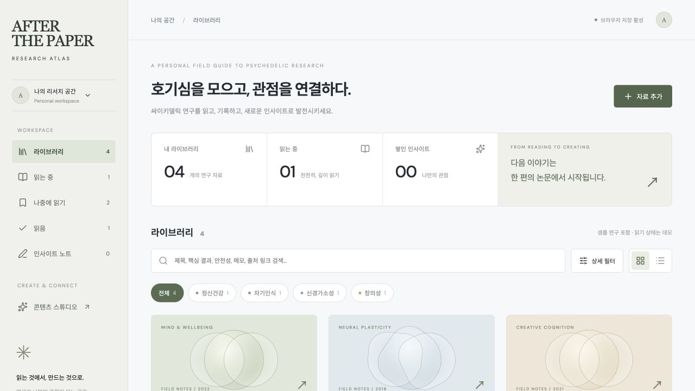
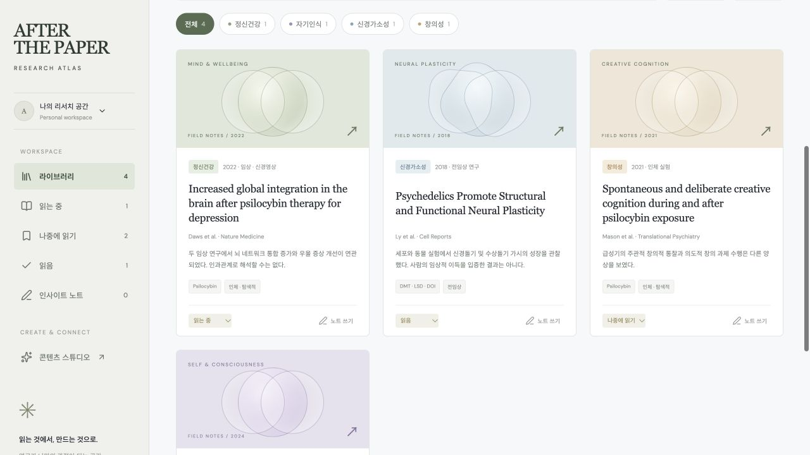
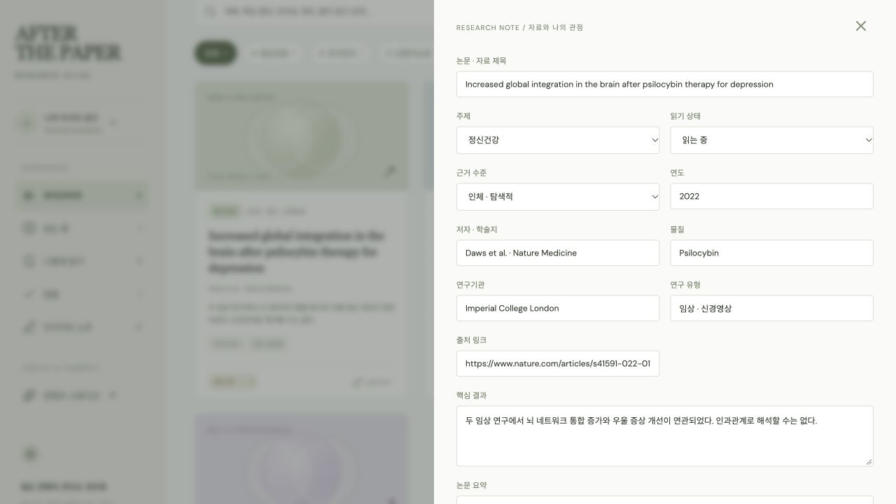
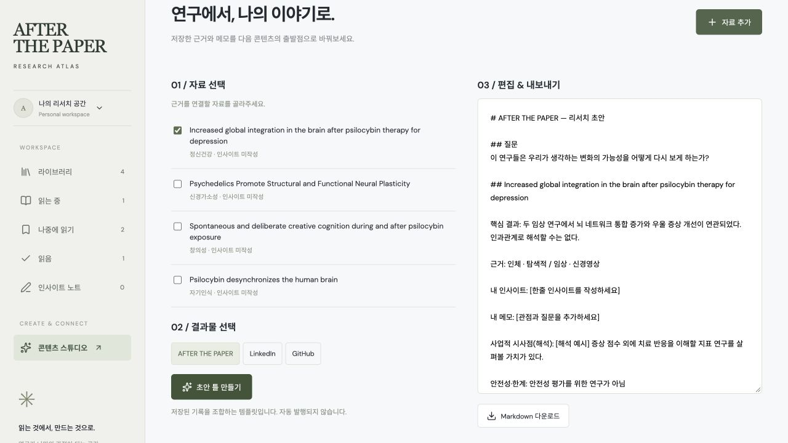

# AFTER THE PAPER
### Research Atlas · 읽는 것에서, 만드는 것으로.

싸이키델릭 연구를 한곳에서 탐색하고, 읽기 기록을 쌓고, 나만의 관점으로 발전시키는 개인 리서치 웹앱입니다.
논문을 읽는 순간부터 AFTER THE PAPER 매거진, LinkedIn 인사이트, GitHub 포트폴리오 초안까지 이어지는 흐름을 만들었습니다.

[웹앱 열기 ↗](https://after-the-paper-research-atlas.lankysun1.chatgpt.site)

> 현재 웹앱은 소유자 전용 비공개 배포입니다. 링크 접근에는 소유자 ChatGPT 로그인이 필요합니다.
> 아래 화면으로 로그인 없이 앱의 모습과 주요 기능을 살펴볼 수 있습니다.

## 화면 미리보기

### 나의 리서치 공간
읽고 있는 연구와 쌓인 인사이트를 확인하는 라이브러리입니다.



### 연구 탐색
정신건강, 자기인식, 신경가소성, 창의성의 네 주제를 탐색하고 각 자료의 읽기 상태를 추적합니다.



### 연구 기록
출처, 물질, 기관, 연구 유형, 근거 수준과 핵심 결과를 구조화하고, 요약·메모·한줄 인사이트를 기록합니다.



### 콘텐츠 스튜디오
선택한 연구의 결과와 한계, 개인 기록을 조합해 매거진·LinkedIn·GitHub용 초안 틀을 만들고 Markdown으로 내보냅니다.



*화면은 샘플 논문만 포함한 로컬 실행 버전에서 촬영했습니다. 개인 메모는 포함하지 않습니다. 스크린샷은 정적 이미지이며 앱과 실시간으로 동기화되지 않습니다.*

## 주요 기능

| 기능 | 내용 |
| --- | --- |
| 자료 검색 | 제목, 핵심 결과, 요약, 안전성, 메모, 출처 링크 등 전체 텍스트 검색 |
| 분류와 필터 | 주제, 물질, 기관, 연구 유형, 근거 수준, 안전성, 사업적 시사점, 출처 |
| 읽기 기록 | 나중에 읽기 / 읽는 중 / 읽음 |
| 나만의 기록 | 논문 요약, 개인 메모, 한줄 인사이트 |
| 콘텐츠 재활용 | AFTER THE PAPER / LinkedIn / GitHub 초안 템플릿 및 Markdown 다운로드 |
| 데이터 이동 | JSON 백업 및 가져오기 |

## 현재 MVP의 범위

- 데이터는 현재 브라우저의 `localStorage`에 저장됩니다. 서버 저장이나 기기 간 자동 동기화는 지원하지 않습니다.
- GitHub에는 이 코드와 소개 자료가 저장됩니다. 앱의 개인 기록과 GitHub를 직접 동기화하는 기능은 아직 구현하지 않았습니다.
- 가져오기는 기존 목록에 추가합니다. 같은 백업을 반복해서 가져오면 자료가 중복될 수 있습니다.
- 콘텐츠 스튜디오는 저장된 기록을 조합하는 템플릿이며 AI 자동 작성이나 외부 플랫폼 자동 발행 기능이 아닙니다.
- 실제 출처 링크를 갖춘 샘플 논문 4편이 포함됩니다. 읽기 상태는 데모입니다.
- 근거 수준은 편집용 분류이며 공식적인 근거 평가가 아닙니다. 연구 결과와 개인 해석은 구분해 기록합니다.

## 로컬 실행

Node.js **22.13 이상**이 필요합니다.

```bash
npm run install:ci
npm run dev
```

```bash
# 프로덕션 빌드
npm run build
```

Sites 프로젝트 ID는 이 저장소에 포함하지 않았습니다. 별도 Sites 배포 시 새 프로젝트에 연결해야 합니다.

## 구성

- `app/page.tsx` — 라이브러리, 검색·필터, 편집, 콘텐츠 스튜디오
- `app/globals.css` — 반응형 스타일
- `docs/images/` — README용 실제 화면 캡처
- `worker/`, `scripts/`, `lib/` — Sites 및 Vinext 실행 지원

**React 19 · TypeScript · Vinext / Vite · Lucide · Sites**

초기 앱은 TypeScript 검사와 프로덕션 빌드를 통과했으며, 주제 필터, 노트 저장 및 새로고침 후 유지, 콘텐츠 초안 생성 흐름을 확인했습니다.

## 다음 단계

- 비공개 연구 데이터 백업 흐름 정리
- 가져오기 중복 처리 및 충돌 관리
- 연결 환경에서 지원 여부를 확인한 뒤 GitHub 저장·불러오기 기능 확장
